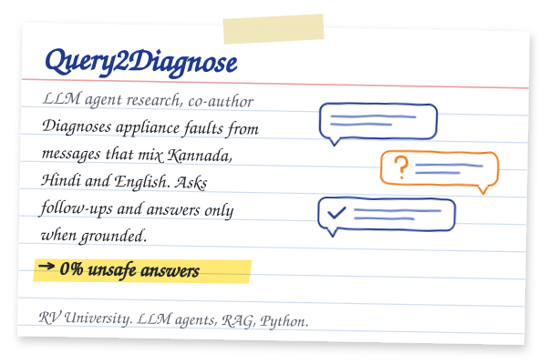
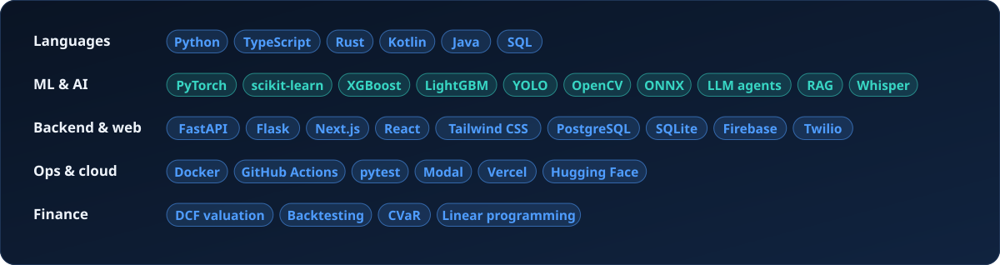

&nbsp;&nbsp;

Hi, I'm Priyanshu. I study computer science (AI and ML) at RV University in Bengaluru, with a minor in finance. I like building the whole thing, from training the model to shipping an app people can open. Mostly, I care about what a system does when it *doesn't* know the answer.

## Ask the model

## Things I've built

## More builds

| Project | What it does | Built for |
|---|---|---|
| **[Kaavalu](https://github.com/Priyanshu-senapati/kaavalu)** | On-device Android app that spots a "digital arrest" scam call while it's happening | App Lab, Kalpavikas 2.0 |
| **[Chaabi](https://github.com/Priyanshu-senapati/UGREEN)** | Privacy-first AI skill that maps a family's assets and nominees from a home NAS | UGREEN AI NAS Hackathon 2026 |
| **[Karigar AI](https://github.com/gd23456/SIH2026)** | Cut photo processing from 30 s to 1 s, with a 9-language UI | Smart India Hackathon 2026 |
| **SETHU (AgroSense)** | Satellite data and XGBoost warn rice farmers of crop stress 10–14 days ahead, by SMS | Asian Hackathon for Green Future, Top 30 |
| **ClaimCourt AI** | Insurance claims argued by defense, prosecution and auditor agents, decided by a rule engine | AI Build Sprint |

## Where I've worked

**Quantitative Developer Intern, Opendaddy Fintech** (June to July 2026) 
Built on-demand stock ranking for US and Indian markets on an explainable analysis platform, fixed NSE/BSE ticker resolution and a calibration bug that made "Buy" unreachable, and shipped 50 commits through reviewed pull requests.

## What's in my toolbox

I'm looking for AI/ML and software engineering internships for 2027. [Message me on LinkedIn](https://www.linkedin.com/in/priyanshu-senapati/).

