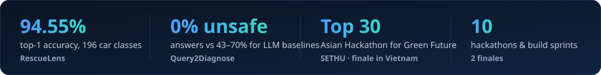
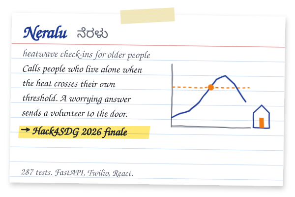
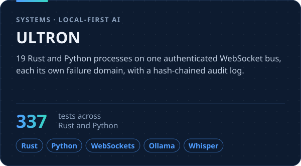
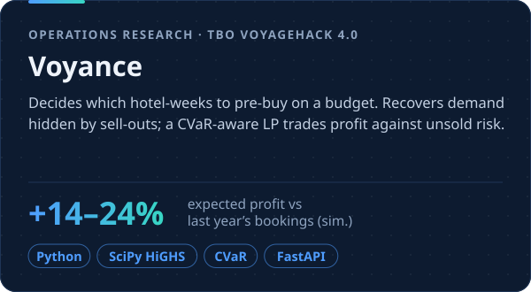

&nbsp;&nbsp;

I'm a third-year B.Tech CSE (AI & ML) student at **RV University, Bengaluru**, with a minor in finance. I like building the whole thing: train the model, test the backend, ship an app people can open. What I care about most is what a system does when it *doesn't* know the answer, so my models abstain, my safety rules stay out of the model's hands, and every claim comes with tests.

## Featured work

## More builds

| Project | What it does | Where |
|---|---|---|
| **[Kaavalu](https://github.com/Priyanshu-senapati/kaavalu)** | On-device Android app that spots a "digital arrest" scam call while it's happening | App Lab, Kalpavikas 2.0 |
| **[Chaabi](https://github.com/Priyanshu-senapati/UGREEN)** | Privacy-first AI skill that maps a family's assets and nominees from a home NAS | UGREEN AI NAS Hackathon 2026 |
| **[Karigar AI](https://github.com/gd23456/SIH2026)** | Cut photo processing from 30 s to 1 s, with a 9-language UI | Smart India Hackathon 2026 |
| **SETHU (AgroSense)** | Satellite + XGBoost crop-stress warnings for rice farmers, 10–14 days ahead by SMS | Top 30, Asian Hackathon for Green Future |
| **ClaimCourt AI** | Insurance claims argued by defense, prosecution and auditor agents; a rule engine decides | AI Build Sprint |

## Experience

**Quantitative Developer Intern · Opendaddy Fintech** (Jun – Jul 2026) 
Built on-demand stock ranking for US and Indian markets on an explainable analysis platform, fixed NSE/BSE ticker resolution and a calibration bug that made "Buy" unreachable, and shipped 50 commits through reviewed PRs.

## Toolbox

**Open to AI/ML and software engineering internships for 2027.** The fastest way to reach me is [LinkedIn](https://www.linkedin.com/in/priyanshu-senapati/).

